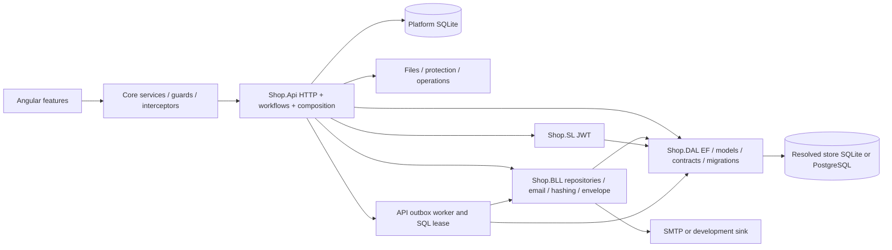
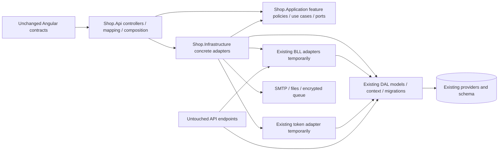

# E-commerce — Refactoring context and proposed implementation plan

Status: Phases 0–10 IMPLEMENTED and verified (2026-10-28); one pre-existing Windows operations-test failure remains explicitly documented. No deployment/commit/push.
Date: 2026-10-27. This is the persistent decision, evidence and phase ledger.

## 1. Baseline and limits

Assessment read in full: `C:/Users/moham/Downloads/# E-commerce Code-Quality and Archi.txt`.
Assessment commit and current HEAD: `4a4a1a05b180a63963d77fcaecd9104100b34c61`.
Initial working tree and diff against the assessed commit were empty. There are no post-assessment code changes. The earlier management UI work is included in this assessed baseline.

At the initial planning checkpoint, static verification covered source, project/lock files, routes, middleware, mappings, schema configuration and test assertions. No implementation/build/test was performed at that planning checkpoint; subsequent user-authorized execution is recorded below. Historical test results are not a current baseline. This is not a penetration test or package advisory audit. The separate reference project was not supplied and its claims were not independently verified.

The planning checkpoint created only REFACTORING_CONTEXT.md. The user subsequently approved Phase 0 and all remaining phases; execution details below supersede that initial gate. Commits, pushes, deployment and real data/schema changes remain unauthorized. At each phase entry refresh HEAD/status and the exact manifest below; explain additional files before editing.

## 2. Verified architecture findings

Paths are repository-relative; symbols anchor evidence independently of line-number changes.

| ID | Verification at HEAD | Treatment |
|---|---|---|
| F-01 | Confirmed: `src/Shop.Api/Controllers/CheckoutController.cs` PlaceOrder/PlaceCore/Quote own queries, receipt SQL, transaction, calculation and response. `Controllers/Merchant/MerchantOrdersController.cs` UpdateStatus owns stock/state/transaction. MerchantProductsController owns quota/variants/gallery/save. | Extract complex workflows after characterization, not a service per controller. |
| F-02 | Confirmed: Program.cs and `src/Shop.SL/TokenManager/TokenService.cs` read raw JWT values; expiry int.Parse; no JwtOptions/ValidateOnStart found. appsettings contains a development placeholder. | Typed validated options, explicit valid local/test configuration; never expose values. Startup hardening is an intentional behavior change requiring approval. |
| F-03 | Confirmed: `src/Shop.BLL/Response_VM/ApiResponse.cs` duplicates HTTP status in body. Delivery/currency/status/platform paths return bare NotFound/Conflict. Model validation uses envelope; exception middleware manually serializes default JSON. | Freeze actual per-path behavior. Universal error normalization would change contracts and is deferred. |
| F-04 | Confirmed: IRepoWrapper exposes entity repositories and synchronous Save; GenericRepo.Query exposes IQueryable; RepoWrapper constructs repositories; complex controllers also use ShopContext. | Feature-specific ports only where transactional/query complexity warrants them. No new generic repository. |
| F-05 | Confirmed: `src/Shop.Api/Security/OrderReturnsService.cs` combines action/state switch, refund math, SQL/CAS, serializable transaction, stock, audit/outbox. EmailOutbox combines SQL lease/retry/encryption. | Separate rules/orchestration/storage while keeping atomic SQL and shared transaction. |
| F-06 | Confirmed: tests/Shop.SchemaChecks is a console executable outside Shop.sln. Fifteen PowerShell scripts exist, including schema launcher. No conventional backend test project or Angular source spec files found. | Keep scripts; add focused tests incrementally. No present coverage percentage claimed. |
| F-07 | Confirmed for inspected request workflows: async EF calls omit request cancellation; UtcNow is direct. Workers already take cancellation. | Add IClock only where useful; cancellation must respect ambiguous commit/replay. No mechanical retrofit. |
| F-08 | Confirmed with qualification: role/state/action strings, USD fallback, image MaxLength(20), outbox five-attempt/retry literals and operational limits. Merchant currencies/status labels/shipping/CMS are already managed data. | Classify technical constants, invariants, vocabulary and configurable settings. Protected transitions are not merchant-editable labels. |
| F-09 | Confirmed: DAL/ViewModels contains HTTP contracts. Merchant delivery/currency/status return entities. MappingProfile already ignores server-owned product/discount write fields. | Selected DTO projections with exact wire equivalence; retain protections. |
| F-10 | Confirmed: Program owns composition/auth events/startup upgrades/pipeline; scoped email setup blocks on StorefrontContent.ReadAsync().GetAwaiter().GetResult(). | Registration cleanup last; awaited email content only after localization/tenant characterization. |

Additional observations/corrections:

1. Checkout's SendOrderSummaryAsync runs before commit, but DI supplies IEmailOutbox; BLL/Email/EmailService enqueues and returns. Normal request flow queues transactionally, not direct SMTP. Preserve shared scoped context; transport fallback is a separate seam.
2. Checkout checks stock but does not reserve/deduct it. Fulfillment first entering Confirmed/Processing/ReadyToShip/Shipped/Delivered deducts once using StockDeducted. Two pending orders may coexist; do not silently introduce checkout reservations.
3. Quote/place differ in grouping, validation precedence, variant error status/message and missing-settings handling. Share only equivalent math; preserve endpoint-specific decisions until a separately approved product change.
4. Checkout hash uses serialized request, not canonical cart semantics. Preserve hashing order, stored receipt JSON and regenerated tracking proof; do not normalize/reorder lines first.
5. PlatformController.CreateCore uses staged writes across platform and new tenant databases, not a distributed atomic transaction. Preserve Provisioning/Failed/unavailable states and final activation ordering.
6. Provisioning seed-cleanup DELETE statements exist only behind new/empty-target guards. Never reuse them on an existing merchant DB or execute them in this analysis. Rollback must not delete tenant data.
7. ApiExceptionMiddleware uses default JsonSerializer, unlike MVC web serialization. Snapshot actual casing/nulls/body/content-type and X-Error-Reference; bare/auth/rate-limit responses need not match envelope today.
8. Do not adopt the assessment's TimeProvider suggestion by silently adding a package/framework upgrade: use a minimal IClock on current net7.0 if needed.
9. Program's PlatformContext is SQLite-only; ShopContext supports SQLite and PostgreSQL via Tenancy/StoreConnections.cs. No platform provider migration is part of this plan.

## 3. Dependencies and diagrams

Declared backend packages, unchanged:

| Project | Project references / package versions |
|---|---|
| Shop.Api (net7.0) | BLL, SL, DAL; EF Design 7.0.20 (private tooling), Npgsql EF 7.0.18, AutoMapper + DI 12.0.0, JwtBearer 7.0.20, Swashbuckle 6.5.0, SkiaSharp + Linux native assets 3.119.4 |
| Shop.BLL (net7.0) | DAL; EF Core 7.0.20; Identity.Core 7.0.20 |
| Shop.DAL (net7.0) | EF Core/Relational/SQLite 7.0.20; Npgsql EF 7.0.18 |
| Shop.SL (net7.0) | DAL; System.IdentityModel.Tokens.Jwt + Microsoft.IdentityModel.Tokens 7.0.3 |
| Shop.SchemaChecks (net7.0 Exe) | DAL; not in solution |

All production projects enable nullable. Package versions are inventoried, not declared vulnerability-free. Different direct JWT versions warrant resolved-graph review during approved baseline; framework/package modernization is a separate proposal. No new MediatR/CQRS/event bus/domain project/generic result hierarchy/mapping framework is justified.

Angular package.json requests Angular 18.2 family, RxJS ~7.8, TS ~5.5 and zone ~0.14. package-lock resolves Angular core 18.2.14, CLI 18.2.21, RxJS 7.8.2, TypeScript 5.5.4, zone.js 0.14.10. Jasmine/Karma/coverage packages exist; no source specs found and generators skip tests. Keep current tooling and lockfile. package-lock.backup.json also exists; active package-lock.json remains authoritative, no cleanup now.

Frontend coupling verified: app.config.ts initializes language/runtime; ApiService unwraps data; checkout retains full envelope. CheckoutService persists pending submissions by hostname/owner and clears on HTTP 400 or X-Checkout-Outcome=NotCreated. Auth interceptor chooses platform/merchant/customer JWT by path. Features read error.message; statusCode remains declared even where direct branching was not found. Runtime guards depend on SaaS/Standalone, Commerce/Catalog, store feature names and current routes. Headers, enum wire forms, messages and token claims must remain compatible.

Current dependencies (arrows mean depends on/calls):

Proposed transitional compile-time dependencies (Infrastructure IMPLEMENTS Application ports; Application never references Infrastructure):

Add Application with first tested policy, Infrastructure with first actual workflow adapter. Keep DAL migrations and untouched BLL/SL in place. Application commands/results are minimal feature-owned records, not DAL entities/ViewModels. No HTTP/EF/IQueryable/provider types in ports. No global project rename.

## 4. Decisions and protected behavior

- D1: Preserve exact routes/methods/status/body casing/types/nulls/messages/headers/enums. Keep ApiResponse.statusCode. ProblemDetails, new public codes and universal error envelopes need separate approval.
- D2: Preserve Merchant/Customer/PlatformAdmin, store_id, store_security_version, session_stamp, actor_id, signing algorithm/lifetime and existing validation for valid config. No key rotation. Unsafe-config startup rejection is explicit hardening only.
- D3: Preserve host resolution, SaaS/Standalone, Commerce/Catalog, feature/quota/subscription gates, and existing 404/401/403 distinctions.
- D4: Preserve decimal arithmetic/order/caps/rounding, discount time boundaries, shipping, fallback currency, tax zero. No tax/currency conversion changes.
- D5: No checkout reservation. Keep conditional stock updates, StockDeducted and state concurrency; restore only current cancellation/return conditions.
- D6: Same isolation/shared context and commit boundaries for order+receipt+outbox and return+audit+stock+outbox. Provisioning remains staged across databases.
- D7: Keep email localization and Angular translation/fallback. No mass message-to-key replacement.
- D8: Cash checkout and manual refund records remain; no actual gateway transfer implied.
- D9: Zero schema/migration/seed/history/provider change. No live database operation or reset.
- D10: Surprising or ambiguous business behavior is characterized and raised, never silently corrected.

## 5. Prioritized backlog

0/P0 isolated baseline + approved security config; 1/P0 characterization/contract safety net; 2/P1 small order/discount policies; 3/P1 fulfillment service; 4/P1 checkout; 5/P1 product lifecycle; 6/P1 returns; 7/P1 recovery; 8/P1 provisioning/subscriptions; 9/P2 outbox infrastructure; 10/P2 selected DTO/composition cleanup. All dependencies are sequential unless a reviewed slice proves independence. No large rewrite or service-per-CRUD rule.

## 6. Phase manifests and execution gates

Exact proposed paths follow. New means not present now. Manifests must be refreshed before each phase; no empty future files are created preemptively. Each slice includes this context update. These are PLANS, not current edits.

### Phase 0 — baseline, then explicit security configuration hardening (completed; original manifest)

Files: `src/Shop.Api/Program.cs`; `src/Shop.SL/TokenManager/TokenService.cs`; new `src/Shop.SL/TokenManager/JwtOptions.cs`; new `src/Shop.Api/Configuration/JwtOptionsValidator.cs`; `tests/security-smoke.ps1`; new `tests/jwt-configuration-checks.ps1`; new `tests/run-refactoring-baseline.ps1`; new `docs/32-refactoring-baseline.md`; `README.md`. No project/package/lock/frontend/migration edits planned. If resolved options APIs require an extra reference, explain it before proceeding.

Justification/responsibilities: record original behavior BEFORE adding guards. API validates typed configuration; SL issues tokens from the same effective values. Preserve source precedence (email-secrets then environment), claims, issuer/audience/algorithm/lifetime for valid config. Do not rotate keys or print values. Document local secret provisioning and generated isolated test keys.

Rules: reject blank/known placeholder/undersized signing key and invalid required issuer/audience/expiry. Before coding, enumerate exact accepted expiry bounds/placeholder rules for approval; do not silently reduce a supported lifetime or require HTTPS-form issuer strings. Minimum byte length is not proof of entropy. This startup change is intentional security hardening.

API/Angular: no HTTP/claim changes for valid config; unsafe deployment startup intentionally fails. Database/transaction: none; invalid-config tests must fail before startup database work. Tests: original isolated baseline first; valid environment override, blank/placeholder/malformed options, wrong signing key/issuer/audience, all three roles, modes, redacted diagnostics.

Acceptance: sanitized baseline records pass/fail and existing failures; approved unsafe configurations fail before database creation; valid configurations preserve auth and all previously passing checks. Rollback: reviewed restoration of phase wiring/validation only; correct external valid config rather than restore a known shared production key. No commit/revert operation without approval.

### Phase 1 — characterization and contract safety net

Files: `Shop.sln`; new `tests/Shop.RegressionTests/Shop.RegressionTests.csproj`; new `tests/Shop.RegressionTests/ApiContractTests.cs`, `WorkflowCharacterizationTests.cs`, `MappingContractTests.cs`; new `tests/fixtures/refactoring/contracts.json`; `tests/run-refactoring-baseline.ps1`; new `client/src/app/core/services/checkout.service.spec.ts`, `api.service.spec.ts`; new `client/src/app/core/interceptors/auth.interceptor.spec.ts`. No production frontend edit.

Justification/responsibilities: tests record observable behavior before relocation. Select exact net7-compatible xUnit/Test SDK versions at phase entry and disclose test-only dependencies; no mocking library initially. Isolated process fixtures can use the existing harness design, without changing host architecture.

Rules: golden status/content-type/body fields/casing/nulls/messages/headers plus durable effects; normalize only identified nondeterministic values, never omit business fields. No real store PII/secrets in fixtures. API/Angular: test data unwrap, error text, pending request recovery and role token routing with existing Jasmine/HTTP testing facilities. Database: disposable SQLite and temporary PG tenant DBs, SQLite registry; never EF InMemory for relational proofs or user databases.

Required tests: section 7 matrix, model validation/bare/auth/middleware errors, AutoMapper configuration and server-owned write fields. Acceptance: tests discover/run, branch matrix captured, no altered production behavior; failures recorded, not silently fixed. Rollback: remove only newly added wiring/files through reviewed patch if approved; all existing checks remain.

### Phase 2 — small policies (2A before 2B)

2A files: `Shop.sln`; new `src/Shop.Application/Shop.Application.csproj` (net7.0, no external packages); new `src/Shop.Application/Orders/OrderStatusTransitionPolicy.cs`; `src/Shop.Api/Shop.Api.csproj`; `src/Shop.Api/Controllers/Merchant/MerchantOrdersController.cs`; new `tests/Shop.Application.Tests/Shop.Application.Tests.csproj`; new `tests/Shop.Application.Tests/Orders/OrderStatusTransitionPolicyTests.cs`.

2B files: new `src/Shop.Application/Checkout/DiscountPolicy.cs`; new `src/Shop.Application/Common/IClock.cs`; new `src/Shop.Api/Adapters/SystemClock.cs`; `src/Shop.Api/Controllers/CheckoutController.cs`; `src/Shop.Api/Program.cs`; new `tests/Shop.Application.Tests/Checkout/DiscountPolicyTests.cs`.

Justification/responsibilities: deterministic decisions leave controllers; controllers retain loading/transactions and response order. Translate DAL enum values explicitly to feature values with exhaustive mapping tests; do not move stored enums or reference DAL from Application.

Rules: preserve delivered/cancelled and same-definition no-op precedence, same-behavior/different-ID cases, deduct/restore flags; discounts unknown/inactive/expired skipped, original messages/cap/decimal math/inclusive time boundaries. Quote/place keep their distinct validation. SystemClock returns UtcNow.

API/Angular and DB/transactions: unchanged. Tests: complete order behavior pairs x stock flag with definition identity cases; fixed/percentage/cap/time boundaries; controller regressions. Acceptance: pure tests require no EF/HTTP, policy results and wire snapshots identical. Rollback: restore policy calls/DI; no enum storage or data change.

### Phase 3 — fulfillment use case and first infrastructure adapter

Files: `Shop.sln`; new `src/Shop.Infrastructure/Shop.Infrastructure.csproj`; new `src/Shop.Infrastructure/Orders/EfOrderFulfillmentStore.cs`, `OrderNotificationAdapter.cs`; new `src/Shop.Application/Orders/OrderFulfillmentService.cs`, `OrderFulfillmentContracts.cs`, `IOrderFulfillmentStore.cs`, `IOrderNotification.cs`; `src/Shop.Api/Controllers/Merchant/MerchantOrdersController.cs`; new `src/Shop.Api/Mapping/OrderOutcomeMapper.cs`; `src/Shop.Api/Program.cs`; `src/Shop.Api/Shop.Api.csproj`; new `tests/Shop.Application.Tests/Orders/OrderFulfillmentServiceTests.cs`; new `tests/Shop.Infrastructure.Tests/Shop.Infrastructure.Tests.csproj`; new `tests/Shop.Infrastructure.Tests/Orders/OrderFulfillmentTransactionTests.cs`.

Justification/responsibilities: controller binds/authorizes/maps; service owns rule sequence; adapter loads aggregate, performs conditional updates and owns workflow-specific transaction scope. Existing email wrapped temporarily; no HTTP/EF/DAL models in Application. No new generic UoW; one workflow-specific transaction callback/scope suffices.

Rules: same status precedence, grouped quantities, active checks, stock flag, concurrency tokens, notification recipients and rollback. API/Angular: existing PUT status route, bool/envelope/messages/status; list untouched. Database: same scoped ShopContext/transaction, no independently committing ports/schema change.

Tests: repeated confirm/cancel, terminal behavior, dynamic statuses, variant/simple stock, parallel last-unit confirmation, later-line failure rollback, enqueue failure rollback on both providers. Acceptance: UpdateStatus has no EF/transaction/stock orchestration; matrix and integration checks pass. Rollback: restore old controller wiring; never reverse stock as part of code rollback.

### Phase 4 — checkout (Quote first, then Place)

Files: new `src/Shop.Application/Checkout/CheckoutService.cs`, `CheckoutContracts.cs`, `ICheckoutStore.cs`, `ICheckoutTrackingAccess.cs`; new `src/Shop.Infrastructure/Checkout/EfCheckoutStore.cs`, `CheckoutTrackingAdapter.cs`; `src/Shop.Api/Controllers/CheckoutController.cs`; new `src/Shop.Api/Mapping/CheckoutOutcomeMapper.cs`; `src/Shop.Api/Program.cs`; new `tests/Shop.Application.Tests/Checkout/CheckoutServiceTests.cs`; new `tests/Shop.Infrastructure.Tests/Checkout/CheckoutTransactionTests.cs`; new `tests/Shop.RegressionTests/CheckoutContractTests.cs`.

Justification/responsibilities: service coordinates trusted input/calculation and outcomes; adapter owns receipt/transaction/provider exception mechanics. Preserve exact request fingerprint at API boundary, with actual serialized request and current ordering. Tracking adapter regenerates proof on replay without service locator. Share only equivalent calculation, not endpoint-specific validation behavior.

Rules: cash-only, auth failure never becomes guest, server-derived ownership, serialized fingerprint/key replay, duplicate lines, stock checks without deduction, discount skip, area/currency and expected-total rules, initial status/tax/order number/tracking. API/Angular: exact routes/bodies/headers/messages, especially NotCreated and retry semantics. Database: order+receipt+outbox one commit, same isolation/connection lifetime and PG unique-violation handling; no migration.

Tests: owner/guest/other actor, same/changed replay, inactive/missing variants, aggregate quantity, changed quote, discount boundaries, concurrent same-key/restart, insert/enqueue/commit failures. Cancellation before commit rolls back; ambiguous outcome after commit remains reconcilable by same key. Do not invent NotCreated on unknown commit outcome. Acceptance: no controller receipt SQL/transaction/business orchestration; golden API and effects match on both providers. Rollback: old wiring reads same receipt JSON; no data/schema rollback or new submission key.

### Phase 5 — product lifecycle, variants and galleries

Files: new `src/Shop.Application/Catalog/ProductManagementService.cs`, `ProductManagementContracts.cs`, `IProductCatalogStore.cs`, `VariantChangePolicy.cs`; new `src/Shop.Infrastructure/Catalog/EfProductCatalogStore.cs`; `src/Shop.Api/Controllers/Merchant/MerchantProductsController.cs`; new `src/Shop.Api/Mapping/ProductOutcomeMapper.cs`; `src/Shop.Api/Program.cs`; new `tests/Shop.Application.Tests/Catalog/VariantChangePolicyTests.cs`; new `tests/Shop.Infrastructure.Tests/Catalog/ProductLifecycleTests.cs`.

Justification/responsibilities: small create/update/delete/bulk workflow methods; variant policy protects identity; adapter owns tracked graph/reference queries/save. Leave simple list/detail unchanged.

Rules: current all-products quota count, serializable create, current slug algorithm/unique error, server-owned fields, ordered galleries/null-vs-empty/primary image, stable sold/cart variant IDs, no sold size/color mutation; upload ownership guard stays. API/Angular: same merchant paths/ProductDetailVM and gallery bindings. Database: retain SaveChanges atomicity; do not add isolation/locks to update silently. No schema change.

Tests: capacity race, duplicate/foreign IDs, used variant delete/change, image 20/null/empty/order limits, no partial mutation on rejection, bulk calculations/overflow and slug conflict. Acceptance: equivalent galleries/stock/variant IDs; product-order and tenant checks pass. Rollback: restore mapping/workflow calls; no reseed/ID replacement.

### Phase 6 — returns

Files: new `src/Shop.Application/Returns/ReturnPolicy.cs`, `ReturnService.cs`, `ReturnContracts.cs`, `IReturnStore.cs`; new `src/Shop.Infrastructure/Returns/SqlReturnStore.cs`; `src/Shop.Api/Security/OrderReturnsService.cs` (temporary facade); `src/Shop.Api/Controllers/ReturnsController.cs`; `src/Shop.Api/Controllers/Merchant/MerchantReturnsController.cs`; `src/Shop.Api/Program.cs`; new `tests/Shop.Application.Tests/Returns/ReturnPolicyTests.cs`; new `tests/Shop.Infrastructure.Tests/Returns/ReturnAtomicityTests.cs`.

Justification/responsibilities: policy owns transition/refund/notes decisions, service owns sequence, adapter keeps parameterized SQL/CAS/audit/restock/outbox in one serializable transaction. Internal enum/constant names do not change public strings.

Rules: ownership/private proof, delivered+stock-consumed eligibility, identical-key replay, cumulative non-rejected quantity, original proportional refund excluding shipping/floor cents, Receive-only optional restock, manual refund/ref required when positive. API/Angular: same routes/entries/error semantics. Database: same tables/decimal strings/version update/shared commit.

Tests: complete state/action matrix, stale version/parallel Receive, mismatch replay, exact fractional caps/zero/precision, unavailable original stock/overflow guard, audit/enqueue failure rollback. Acceptance: same transitions and effects, no double stock, both providers pass. Rollback: restore facade; no SQL migration or restock compensation job.

### Phase 7 — recovery/authentication boundary, scoped to recovery first

Files: new `src/Shop.Application/Accounts/CustomerRecoveryService.cs`, `RecoveryContracts.cs`, `ICustomerRecoveryStore.cs`; new `src/Shop.Infrastructure/Accounts/CustomerRecoveryAdapter.cs`; `src/Shop.Api/Controllers/CustomerRecoveryController.cs`; `src/Shop.Api/Security/CustomerEmailSecurity.cs`; `src/Shop.Api/Program.cs`; new `tests/Shop.Application.Tests/Accounts/RecoveryPolicyTests.cs`; new `tests/Shop.Infrastructure.Tests/Accounts/RecoveryAtomicityTests.cs`.

Justification/responsibilities: extract recovery orchestration, keep hashing/token technical adapters. Ordinary login/social flows are not rewritten; inspect separately if future complexity warrants it.

Rules: identical known/unknown response, purpose-bound expiring single-use proof, reset session revocation, localized encrypted email, no logs/secrets, no-store/rate limits. API/Angular: same account paths and current nested messages. Database: same token/hash/stamp representations and consume transaction/tenant scope. Tests: enumeration, purpose swap, expiry/replay, concurrent consume/reset, enqueue failure, cross-store proof and JWT invalidation. Acceptance: no role/claim/lifetime change; security/account email/localization suites pass. Rollback: old adapter wiring only, never restore passwords or consumed tokens.

### Phase 8 — merchant provisioning/subscription workflow

Files: new `src/Shop.Application/Provisioning/StoreProvisioningService.cs`, `ProvisioningContracts.cs`, `IStoreProvisioner.cs`, `IPlatformRegistrationStore.cs`; new `src/Shop.Infrastructure/Provisioning/StoreProvisioner.cs`, `PlatformRegistrationStore.cs`; `src/Shop.Api/Controllers/Platform/PlatformController.cs`; `src/Shop.Api/Program.cs`; new `tests/Shop.Infrastructure.Tests/Provisioning/ProvisioningFailureTests.cs`; new `tests/Shop.Application.Tests/Provisioning/ProvisioningServiceTests.cs`.

Justification/responsibilities: API supplies authorized actor/request; application controls existing stages; infrastructure validates identities and initializes fresh target. Tenancy implementations may be wrapped without moving middleware/schema simultaneously. Subscription CRUD is not automatically extracted.

Rules: reserved hostname, canonical identity/alias rejection, new/empty target, pending version gate, plan snapshot/trial/manual paid proof, final activation and failed-unavailable states. API/Angular: unchanged approval/store creation paths/statuses/messages. Database: current independent platform/tenant stages, not distributed transaction; no automatic adoption/retry/delete/schema change.

Tests: failure before/after registry, tenant init/commit and final platform save; simultaneous approval, aliases/hosts/existing DB, trial/payment/suspension. Acceptance: no existing tenant touched, partial store remains unavailable and stage behavior matches baseline. Rollback: code only; leave failed resources unavailable for explicit operator reconciliation, never delete as compensation.

### Phase 9 — outbox infrastructure

Files: new `src/Shop.Application/Notifications/IEmailQueue.cs`; new `src/Shop.Infrastructure/Notifications/SqlEmailQueue.cs`, `OutboxDeliveryService.cs`, `EmailPayloadProtector.cs`; `src/Shop.Api/Security/EmailOutbox.cs`; `src/Shop.Api/Security/EmailOutboxWorker.cs`; `src/Shop.Api/Program.cs`; new `tests/Shop.Infrastructure.Tests/Notifications/OutboxLeaseTests.cs`. Existing BLL IEmailOutbox stays as compatibility adapter until callers migrate.

Justification/responsibilities: separate SQL lease/crypto/transport, hosted lifecycle remains API. Rules: original crypto purpose/key ring/tenant paths, five automatic attempts, two-minute lease, existing backoff/expiry/payload clearing, manual retry/history and per-store mail settings. Do not promise exactly-once SMTP: crash after send before acknowledgement is inherently uncertain; characterize, do not silently change guarantee.

API/Angular: same history/retry shapes; payload/secrets excluded. Database: same parameterized CAS, lease+attempts transaction; enqueue uses caller's context. Tests: competing workers/lease expiry/crash window, encrypted restart/restore, attempt limits/expiry. Acceptance: no plaintext durable payload or cross-tenant delivery; email/outbox/ops checks pass. Rollback: restore adapters while retaining key purposes/ring and schema so queued mail remains readable.

### Phase 10 — selected DTOs, result mapping and composition

10A files: new `src/Shop.Api/Contracts/Merchant/DeliveryContracts.cs`, `CurrencyContracts.cs`, `OrderStatusContracts.cs`; `src/Shop.Api/Controllers/Merchant/MerchantDeliveryController.cs`, `MerchantCurrenciesController.cs`, `MerchantOrderStatusesController.cs`; new `tests/Shop.RegressionTests/ManagedSettingsContractTests.cs`. Keep legacy DAL contracts until callers are migrated, no global relocation.

10B files: new `src/Shop.Api/Composition/AuthenticationRegistration.cs`, `DataRegistration.cs`, `EmailRegistration.cs`; `src/Shop.Api/Program.cs`; `src/Shop.BLL/Email/EmailService.cs`; new `src/Shop.Infrastructure/Notifications/StoreEmailComposer.cs`; new `tests/Shop.RegressionTests/HostCompositionTests.cs`; new `tests/Shop.Infrastructure.Tests/Notifications/EmailLocalizationTests.cs`.

Justification/responsibilities: explicit API DTO projections, then readable registration groups and awaited email composition. Program remains composition root; keep pipeline order visible. No hidden service locator or business rules in AutoMapper. Feature-local result mappers preserve existing outcomes.

Rules/API/Angular: exact serialized fields/case/null/enum/messages/bare errors, statusCode retained. New public codes/ProblemDetails/global error normalization require separate approval. Database: same model/migration assembly/history/startup upgrade logic and scoped lifetimes, no schema edit. Tests: exact JSON before/after, overposting prevention, mapping validation, cold startup/auth/host/modes, AR/EN email/CMS/fallback per tenant. Acceptance: selected endpoints no longer expose entities, extracted Application has no EF/HTTP dependencies, blocking scoped read removed with same mail output. Rollback: restore one DTO/registration group at a time, frontend unchanged.

## 7. Feature impact and test coverage gaps

Assertions were inspected statically, not executed. Counts of assertion sites are not coverage or runtime test counts: loops/fixtures/conditional paths differ. Missing below means no adequate focused proof was identified, not a claim that every related branch has no smoke check.

| Feature | Existing evidence retained | Additional required evidence before moving |
|---|---|---|
| Checkout/retry | checkout-integrity: cash/card, key/session/owner, replay/change, price replay, notification duplication, concurrent same key/restart. product-order: total/discount/area/variants/stock. | Exact status/body/casing/header snapshots; validation precedence and serialized fingerprint; injected failure between order/receipt/enqueue/commit; ambiguous commit/cancellation; missing settings. |
| Fulfillment | product-order: competing confirmations, state/stock and persisted variant identity. returns: delivered cannot reopen. | Exhaustive state x state x stock-flag and dynamic definition identity matrix; multi-line/enqueue rollback; real-provider concurrency outcomes. |
| Catalog/images/quota | product-order, storefront, upload-tracking, tenant-isolation and onboarding cover gallery/variant/stock/config flows. | Pure variant policy, null/empty/order/20-image limits, duplicate slug/error shape, concurrent quota, rejected mutation leaves data unchanged, bulk boundaries. |
| Returns | returns: ownership/private proof, partial quantities, replay, cap/reference, manual refund, repeated and parallel variant restock/other variant unchanged. | Full action/state matrix, stale and changed replay, precise floor rounding/zero, audit/enqueue rollback, unavailable original stock/overflow branches. |
| Auth/recovery | security-smoke + email-account-security: roles, reset revocation, single-use, purpose mismatch, expiry, enumeration-safe result. | Startup options and signing-key/issuer/audience negative matrix, raw serialization, concurrent consumption and tenant-proof tests. |
| Outbox | email-outbox: failed transport does not lose order, five attempts, restart/manual retry/history privacy. account email: replay dedup. | Fixed-time lease/backoff/expiry tests, competing worker and crash window, crypto purpose/key continuity, enqueue transaction fault injection. |
| Tenancy/plans/modes | tenant-isolation, deployment-profile, onboarding, marketplace: host/actor boundaries, quotas/features/trial/paid gates/aggregation. | Provisioning stage fault injection, simultaneous approvals and capacity, full middleware vs use-case actor matrix; mixed SQLite registry/PG tenant environment. |
| Operations | operations: restore rehearsal/assets/hash/private paths, recovery invalidation, schedules and safe logs. | No initial ops refactor; prove existing paths/key purposes/recovery behavior if adapters move. Never restore a real DB during verification. |
| Localization/frontend | localization/storefront/marketplace: filtering, translated search, composed AR email; Jasmine/Karma installed, no source specs found. | Data-wrapper/auth-interceptor/pending-checkout/runtime-guard tests; customer/merchant/platform browser smoke in AR/EN/mobile after affected contracts. No UI redesign in refactor. |
| Schema/providers | SchemaChecks Program.cs/PostgresChecks.cs + postgres-schema launcher; SQLite version upgrader and PG migrations. | Real-provider adapter constraint/transaction/CAS tests and before/after schema/history equality. EF InMemory cannot prove relational behavior. |

Future baseline runbook (NOT executed):

1. Record HEAD/dirty tree, dotnet SDK/runtime, no-restore resolved dependencies and production schema/migration/lockfile checksums. Never output effective secrets or use live tenant connection strings.
2. Build into dedicated verification output, never overwrite a running API's bin. Pass its DLL explicitly to security-smoke. Build SchemaChecks separately where required. Do not stop current API/UI.
3. Feature scripts rely on helpers/fixtures from security-smoke: use `pwsh -NoProfile -File tests/security-smoke.ps1 -ApiDll <isolated-built-dll> -AdditionalChecks <absolute-feature-script>` with a fresh isolated environment per run. Do not invoke feature extensions standalone. Original report commands suggesting this for all scripts standalone are insufficient.
4. postgres-schema-checks requires explicit PostgresBin; -ApiIsolation currently expects `src/Shop.Api/obj/verification-output/Shop.Api.dll`. Match the isolated build location before running. Use its temporary loopback cluster, not a production instance. Run affected workflows on PG as fixture support allows; document any gap rather than substituting SQLite.
5. dotnet test becomes meaningful after test projects exist. Angular build/focused Jasmine tests use existing locked tooling; no npm install/update. Translation coverage check remains required when messages/mapping are touched.
6. Save sanitized command/provider/pass-fail/count/duration/artifact manifests. Existing failures must be recorded, not asserted fixed or removed. Runtime pass status and coverage remain unknown until this approved execution.

Preserve every existing script/check: `security-smoke.ps1`, `checkout-integrity-checks.ps1`, `product-order-checks.ps1`, `returns-checks.ps1`, `tenant-isolation-checks.ps1`, `upload-tracking-security-checks.ps1`, `email-outbox-checks.ps1`, `email-account-security-checks.ps1`, `operations-checks.ps1`, `storefront-checks.ps1`, `localization-checks.ps1`, `deployment-profile-checks.ps1`, `merchant-onboarding-checks.ps1`, `platform-marketplace-checks.ps1`, `postgres-schema-checks.ps1`, and `Shop.SchemaChecks/Program.cs` + `PostgresChecks.cs`. No assertion removal/weakening.

## 8. Risk matrix

Likelihood is qualitative before controls; impact is business consequence.

| Risk | Likelihood / impact | Mitigation / gate |
|---|---|---|
| JWT guard breaks valid demos or alters tokens | High / critical | Baseline before guards, explicit temporary test keys, valid-config token parity; no rotation |
| Duplicate/lost checkout or broken retry recovery | Medium / critical | Same fingerprint/receipt/headers/status; parallel/restart/ambiguous commit tests |
| Double/partial stock deduction or restock | High / critical | Same CAS/status concurrency and transaction; later-write/enqueue failures, both providers |
| Cross-tenant session/data/asset leak | Medium / critical | Scoped tenant adapter, same host/token stamps, negative host/alias/actor tests; never singleton tenant data |
| DTO/error mapper silently breaks Angular | High / high | Freeze real shapes incl bare errors/casing, client retry/interceptor tests; no universal normalization |
| Provisioning partial store publicly active | High / critical | Faults at every stage, new-empty guard, Failed/unavailable until complete; manual reconciliation |
| Outbox encryption unreadable or uncertain duplicate delivery | Medium / high | Same purpose/key paths, lease/crash/restart proofs; no exactly-once SMTP promise |
| PG/SQLite behavior diverges | High / high | Both real providers, same isolation/SQL, no schema changes |
| Cancellation misreports committed order as not created | Medium / critical | Commit-boundary failure tests, same-key recovery, no invented NotCreated |
| New layers grow without value | Medium / medium | Feature ports only, no empty CRUD wrappers/frameworks/generic repos/namespace megamove |
| Async email content changes language/store settings | Medium / high | Cold-start per-tenant AR/EN email snapshots before blocking-read removal |
| Dependency upgrades obscure behavior regressions | High / high | Separate package/runtime proposal; inventory is not vulnerability clearance |

## 9. Measurable acceptance criteria and rollback

For each approved slice:

- Exact manifest/responsibility delta recorded before editing; baseline dirty files protected. No commit/push/deployment without separate explicit approval.
- Zero schema/migration/upgrader/seed/history/provider changes. Compare source checksums and isolated schema catalogs; retain row IDs and intended fixture effects.
- 100% of captured HTTP cases preserve status, shape/case/types/nulls/messages/headers after only documented nondeterministic normalization. Adding a field/code is not assumed universally safe.
- 100% of previously passing relevant regression checks remain passing, no removed/weakened checks. Both SQLite and PG persistence tests required for accepting extracted adapters; record blockers/failures honestly.
- Exhaustive existing OrderStatus transition and return state/action matrices, plus time/money/refund boundaries. Pure policy tests require no database or HTTP host.
- Application project has zero references to Api/DAL/BLL/SL/Infrastructure, ASP.NET, EF or provider packages; ports expose no IQueryable/DbContext/entity graphs/HTTP types. Keep explicit enum/contract translation tests.
- Converted controller actions only bind/authenticate/map/call use case: no SQL, transaction coordination, stock calculation or state machine in those actions. Untouched simple queries/CRUD may retain data access.
- Fault-injection tests show no partial order/receipt/outbox or return/audit/restock commit; actor/tenant spoof behavior unchanged. Preserve staged provisioning rather than pretend atomicity across DBs.
- Baseline build and focused unit/integration/Jasmine checks pass using isolated output. Backend-only slices leave storefront themes, AR/EN and responsive product behavior unchanged.
- Update this context at phase exit with actual files/tests/results/deviations/risks and rollback readiness. Stop on contract/security/schema ambiguity.

Rollback: reviewed restoration of only phase-specific code/wiring, never whole-tree reset. Git revert/commit still requires explicit approval. Do not roll back live database state, replay stock compensation or delete provisioned tenant DBs. Old code must continue reading unchanged receipts, queue payloads and return records. Leave partial provisioning unavailable for explicit operator action.

## 10. Unresolved decisions / proposed defaults

| ID | Required decision | Safe proposed default |
|---|---|---|
| U1 | Phase 0 exact JWT bounds, placeholder list and local provisioning | Explicit invalid-config rejection; preserve valid configured values/claims; generate isolated test secrets. Present precise bounds before coding. |
| U2 | Phase 1 test package versions and availability | net7-compatible xUnit/Test SDK; no mock package until demonstrated need. |
| U3 | Application/Infrastructure projects | Add only with first tested policy/adapter; keep BLL/SL transitional, no rename. |
| U4 | Global error contract/new codes/ProblemDetails | Deferred; existing shape/status/casing and bare errors preserved. |
| U5 | Quote/place differences and serialized request hashing | Preserve now; any normalization is a separate product proposal. |
| U6 | Merchant transition graph/refund authority | Protected current transitions; cash-only and manual refund records. |
| U7 | Provisioning retry/recovery improvement | Preserve Failed state/manual operator reconciliation; no automatic deletion/saga framework. |
| U8 | Runtime/package security/lifecycle update | Separate audited proposal; no current advisory clearance claimed. |
| U9 | Runtime baseline and coverage numbers | Unknown until approved isolated execution; static inspection is not a pass result. |

## 11. Persistent phase ledger

| Phase | Status | Actual production files changed this session | Evidence |
|---|---|---|---|
| Planning | APPROVED by user | Planning only | Findings, manifests and phase entry updates retained below |
| 0 | COMPLETE (approved continuation) | Program.cs, TokenService.cs; new JwtOptions/validator | Before/after builds and isolated HTTP suites passed; see execution update |
| 1 | COMPLETE | Test projects/specs/HTTP snapshots | .NET + Angular characterization passes |
| 2 | COMPLETE | Application policy project; controller policy calls | Full transition/discount matrix passes |
| 3 | COMPLETE | Fulfillment service + EF session + HTTP mapper | Stock/status rollback on SQLite and PG |
| 4 | COMPLETE | Checkout service/store/receipt codec and mapper | Retry/hash/atomic order-receipt-outbox verified |
| 5 | COMPLETE | Catalog lifecycle/variant policy + EF adapter | Galleries, identities and quotas verified |
| 6 | COMPLETE | Return policy/service/SQL store + facade | Version/audit/restock rollback verified |
| 7 | COMPLETE | Recovery service/store + host link adapter | Purpose, session, language and tenant checks pass |
| 8 | COMPLETE | Staged provisioning + six relocated tenancy helpers | Existing DB guard/stage failure/onboarding verified |
| 9 | COMPLETE with known baseline ops limitation | Queue/crypto/transport ports + SQL adapter | Lease/retry/key-ring tests pass; existing Windows blocked-recovery timeout retained |
| 10 | COMPLETE | Wire-identical DTOs + registration groups + async composer | Contract, cold scope, EN/AR, auth and frontend gates pass |

Planning-session output was REFACTORING_CONTEXT.md only. Subsequent authorized changes and phase manifests are recorded below. No permission for silent product/API changes or commit/push/deploy was inferred.

## Phase 0 execution update — 2026-10-27

User authorized continuation. Executed Phase 0 only; planning sections above describe the original planning-session limits, not current execution status. Detailed evidence and rollback: docs/32-refactoring-baseline.md.

Actual files: modified src/Shop.Api/Program.cs, src/Shop.SL/TokenManager/TokenService.cs, tests/security-smoke.ps1, README.md; added src/Shop.SL/TokenManager/JwtOptions.cs, src/Shop.Api/Configuration/JwtOptionsValidator.cs, tests/jwt-configuration-checks.ps1, tests/run-refactoring-baseline.ps1, docs/32-refactoring-baseline.md; updated this context. No additional production manifest files required; no new packages/projects.

U1 resolved for this slice: key >=32 UTF-8 bytes and no documented placeholder markers; issuer/audience nonblank; expiry positive Int32, omitted=120. No arbitrary lifetime cap/HTTPS issuer, no transformed config values. Shared startup settings prevent issuer/validator drift. Existing valid claim/session behavior preserved, including initially empty store_security_version.

Baseline and after builds passed. HTTP suites before/after: checkout 413/413, deployment 396/396, returns 697/696 (email-poll-count variation; all assertions/scenarios passed). JWT HTTP 172 checks and 14 startup/lifetime configuration cases passed. Invalid config verified to exit before file/DB initialization with redacted diagnostics. Schema/migration source and client lockfile hashes unchanged. PostgreSQL not rerun in this configuration-only slice; no all-provider certification claimed.

Existing warnings remain: NETSDK1138, NU1903 AutoMapper, NU1902 JWT. No upgrades/suppression. Next launch requires private key if using committed demo defaults; existing local key untouched. No live restart, DB operation, frontend/dependency change, commit, push or deploy.

Phase 0: COMPLETE; final test and working-tree review passed. Phase 1: NOT STARTED. Next: characterization/contract tests; refresh manifest and test package versions before implementation.

## Remaining phases execution authorization — 2026-10-27

User explicitly requested all remaining phases. Phase 1 entry: preserve Phase 0 dirty files. Proposed test-only packages xUnit 2.9.3, runner 2.5.6 and Microsoft.NET.Test.Sdk 17.8.0 (net7-compatible); no production package changes. Added manifest files: tests/api-contract-checks.ps1 (HTTP snapshots), tests/fixtures/refactoring/contracts.json; these complement the planned RegressionTests project and three Angular specs. Capture contracts with the existing Phase 0 DLL before production workflow edits. Gates: status/body/header parity, mapping protections, Angular retry/token behavior; no schema/front-end production change. Rollback removes only new test wiring; existing regression checks retained. Infrastructure/policy manifests will be refreshed at each entry.

### Phase 1 evidence and Phase 2 entry (2026-10-28)
10 .NET contract/mapping tests and 13 Angular tests passed. HTTP capture corrected to decode byte[] problem+json before parsing; initial long-running host expired its tokens after a wall-clock interruption, so it is rerun fresh rather than weakening auth checks. An unrelated local CartController message edit appeared while work was running; preserve it and exclude it from refactoring. Phase 2 exact manifests follow section 6: Application project, pure order/discount policy and IClock/SystemClock, Api reference/DI, controller policy calls, Application.Tests; no route/schema/frontend production edits. Existing branch order/messages are invariants; matrix tests and existing HTTP suites gate extraction. Rollback is policy-call/DI restoration only.

Phase 1 accepted: 10 .NET + 13 Angular tests pass; corrected baseline HTTP JSON snapshots captured and Phase 2 HTTP comparison passes. Phase 2 accepted: 263 pure cases; HTTP contracts and product/order regression pass (manifest phase2-ecc21b29362446b792bb62dac1a70d01). Phase 3 entry: section 6 files, consolidated OrderNotificationAdapter into the workflow session adapter to keep the existing shared-context enqueue inside the transaction; no independent notification service/commit. New IOrderFulfillmentSession is feature-specific, not generic UoW. Required tests include fake-session no-commit/conflict/cancellation and SQLite/PG transaction rollback; controller list unchanged. No schema or API change; rollback controller/DI only.

Phase 3 SQLite gates: 266 application tests, two real transaction rollback tests, unchanged HTTP snapshots/product-order checks. Additional test-only manifest file tests/refactoring-postgres-checks.ps1 composes existing isolation with infrastructure tests in the disposable PG cluster. No production database change. First PG run passed 33 schema assertions but could not find this extension because its earlier creation command timed out before execution; no test failure was suppressed. The cluster stopped normally; rerun uses an absolute extension path.

Phase 3 accepted: PostgreSQL 33 schema checks + 318 tenant HTTP checks + two PG transaction rollback tests passed; temporary cluster stopped. Missing pg_dump path was a test prerequisite resolved only in process environment. Phase 4 entry: planned CheckoutService/contracts/store/codec/tracking ports, EF adapter, API outcome mapper and controller/DI; additionally API Adapters/CheckoutBoundary.cs implements receipt codec + tracking + feature capability and mirrors existing wire DTOs. Keep order-number helper adapter-backed (no algorithm change). Hash stays computed from original API request; persisted receipt encoding stays existing ApiResponse<OrderConfirmationResponse>. Validation precedence, shared transaction, fresh replay proof, no reservation and cancellation ambiguity invariant. Tests: HTTP contracts, checkout/restart/concurrent, app/failure-injection cases and PG. Rollback old controller wiring only, no receipt/schema changes.

Phase 4 accepted: 270 application tests, 3 transaction integration tests on SQLite and PG, HTTP snapshots + checkout + returns pass; PG 33 schema +318 HTTP, cluster stopped. Phase 5 entry: planned Catalog service/contracts/store/policy, EF adapter, controller/DI, focused tests. Aggregate snapshots preserve entity IDs; adapter applies scalars and tracked children, no persistence types enter Application. Added internal catalog aggregate types in the planned contracts file. Existing sync SaveChanges and serializable create remain; no new update transaction/isolation. API read projections and raw contracts remain unchanged. Gate: variant references/gallery null-vs-empty/quota and product-order/tenant suites; rollback service/adapter wiring only.

Phase 5 accepted: 273 app tests, four integration tests on both providers; HTTP snapshots/product-order/deployment pass; PG33+318 and isolated cluster cleanup pass. Phase 6 entry: section 6 ReturnPolicy/ReturnService/contracts/IReturnStore/SqlReturnStore/facade/DI and tests. Keep owner/private-proof at existing HTTP boundary; facade receives Order and passes its trusted ID, store reloads inside serializable transaction. Same parameterized SQL/version/audit/refund strings and transaction; optional restock only Receive, manual refund unchanged. No schema/API change. Rollback facade implementation/DI only.

Phase 6 accepted: 303 app tests, five integration tests on SQLite/PG, unchanged HTTP snapshots/returns/tenant checks, PG33+318. Phase 7 entry: planned recovery service/contracts/port/SQL adapter and facade/controller/DI; added API Adapters/AccountLinkSettings.cs to keep HTTP language/host/config out of infrastructure. SQL/token hashing/credential stamps/expiry/purpose are retained byte-for-byte apart from IClock. No login/social/auth middleware changes; facade preserves registration verification caller. Tests: known/unknown recovery paths, existing account-email/localization and tenant proofs; rollback wiring only, never password/token data.

Phase 7 SQLite gates passed (306 app cases; HTTP snapshots/email-account/localization/tenant suites). PostgreSQL result is recorded below once complete. Phase 8 entry expanded manifest: physically relocate PlatformContext.cs, StoreScope.cs, StoreConnections.cs, StorefrontContent.cs, PlanFeatures.cs, DeploymentProfile.cs from Api/Tenancy to Infrastructure/Tenancy, retaining existing namespaces/type names and exact mapping/SQL to avoid a broad caller rename. These mutually dependent host-resident persistence helpers are needed by the provisioning adapter; no schema definition edits. Add explicit IConfiguration using where formerly supplied by Web SDK. No API assembly reference from Infrastructure. Planned provisioning contracts/service/ports/adapter and API mapper/controller/DI; consolidate registration and tenant initialization adapter as a scoped PlatformRegistrationStore with separately named stage methods, not a generic repository. Approval's staged failure/reset logic and existing new-empty DB guards preserved. Test gates: onboarding/marketplace/deployment + injected stage failures + both providers. Rollback wiring and file locations, never delete initialized DBs.

Phase 7 PG gate passed 33 schema +318 HTTP + five integration tests. Phase 8 HTTP contracts/onboarding/deployment/marketplace passed; 309 app tests pass. Infrastructure.Tests adds a framework reference to the already installed Microsoft.AspNetCore.App for ConfigurationBuilder in isolated provisioning tests (test-only, no package or production reference). An accidental renamed word inside one preflight error string was caught by source review and restored before final verification. Final rebuilt Phase 8 gates follow.

Phase 8 accepted: six SQLite/PG integration tests, 309 app cases, HTTP onboarding/deployment/marketplace/contract suites, PG33+318. Phase 9 entry: Application IEmailQueue/metadata and transport/protector/failure-journal ports; Infrastructure SqlEmailQueue and EmailPayloadProtector; API EmailOutbox compatibility facade + Adapters/OutboxFailureJournal.cs + DI. Worker lifecycle remains unchanged. Delivery/CAS remains one cohesive 80-line SQL adapter rather than an empty delivery wrapper. Host supplies unchanged DataProtection purpose StoreEmailOutbox/storeId through a narrow string protector, avoiding an ASP.NET dependency in Application/Infrastructure. Keep lease/attempt/expiry/backoff and history shapes. Tests: multi-worker lease/expiry, encryption restart, current email-outbox and operations/regression checks; rollback facade wiring only, never crypto purposes/key ring or queue data.

Phase 9: eight infrastructure tests and 11 regression tests passed (real protection key-ring compatibility included). Existing operations scheduling check failed on both Phase 0 control DLL and Phase 9: it waits 15 seconds while unconfigured scheduler defaults to 60 seconds. Production scheduler remains unchanged. Test harness now explicitly sets Operations__SchedulerPollSeconds=1, with prior environment restored; no assertions removed/timeouts weakened. Re-run both controls with identical test configuration. This test-only manifest addition is necessary to establish deterministic existing coverage.

Phase 9 accepted with a pre-existing operations limitation: PG33+318 and eight integration tests passed, 11 regression tests pass, API snapshots/email-outbox pass. With explicit scheduler cadence both original and Phase 9 pass the schedule assertions, then both fail at the existing Windows blocked-recovery child process failing to exit within 15s (instance-lock exception before guarded recovery). No production recovery protection or assertions changed. Treat as known baseline failure, not a passing full ops certification. Add test-only timeout child cleanup in tests/operations-checks.ps1 to prevent orphaned test processes; preserve failure. Phase 10 entry: exact section 6 DTOs/controllers + composition classes/Program and async StoreEmailComposer. Added Application/Notifications/IStoreEmailContent.cs, API/Adapters/StoreEmailContent.cs; EmailOptions is scoped and existing transport stays BLL. Remove only sync-over-async CMS read from DI; per-scope first message awaits same content, worker sends queued snapshot. Pipeline/startup upgrade ordering unchanged. HTTP snapshots expanded BEFORE DTO changes for governorates/areas/statuses. Gate: exact shape, enum/null/casing, mapping+email+startup+AR/EN+existing regressions; no schema/public-error normalization. Test files HostCompositionTests, ManagedSettingsContractTests, EmailLocalizationTests; rollback one mapping/registration group at a time.

Phase 10 gates in progress: 17 regression +10 infrastructure tests pass, full 10-suite HTTP manifest phase10-491d69fe36184c0b87480f40137f6bd1 passed. Async content initialization verified in EN/AR; DTO enum/null/nested fields serialized identically. Final review removes obsolete fulfillment controller email/logger injection, preserves direct PostgreSQL serialization-failure translation in catalog create, and removes SDK-added unused x86/x64 solution configs. Formatting limited to refactoring-owned C# files; unrelated CartController edit excluded. Final JWT, PG, Angular build/tests and source/schema hashes follow before marking complete.

## Final execution result — 2026-10-28

All authorized implementation phases 1–10 completed incrementally. Detailed final architecture/results: docs/33-refactoring-implementation.md. No commits, pushes, deployments, current server restart or real merchant database operation. API routes/request types/response envelope/messages/enum wire forms and middleware order retained. Existing CartController text edit is unrelated and preserved.

Final checks: 309 Application +10 Infrastructure +17 Regression tests =336 .NET tests passed; Angular production build +13 ChromeHeadless tests passed; 719 template phrases audited, zero missing. Final JWT matrix 14 configuration/lifetime cases +172 HTTP checks passed. PostgreSQL temporary-cluster run:33 schema assertions +318 tenant HTTP checks +10 infrastructure tests passed (7 provider-dependent transaction tests on PG, one SQLite platform guard and two pure email composition cases); cluster stopped normally. Ten-suite HTTP manifest phase10-491d69fe36184c0b87480f40137f6bd1 all passed; counts reflect nested suites/polling, not unique coverage percentage. Final focused HTTP confirmation is recorded separately.

Verified hashes/source diff: all Shop.DAL models/data/migrations unchanged; existing production package references and Angular manifest/lock unchanged. Api adds only Application/Infrastructure project references; test-only xUnit/runner/Test SDK packages and test framework reference documented. Six mutually dependent tenancy helpers moved to Infrastructure without renaming their legacy namespace/type names or changing platform model mappings. Scoped contexts and DataProtection application/purpose/key paths unchanged.

Accepted deviations: feature-local transaction session ports instead of generic UoW; cohesive SQL queue adapter rather than empty delivery wrapper; HTTP scalar copy keeps current contracts at edge; facade classes keep existing registration/return/worker callers. Untouched simple CRUD/query controllers may still use existing repositories/EF. BLL/SL and remaining DAL ViewModels are transitional by design, not a claimed full clean-architecture conversion.

Known baseline failure: operations-checks on BOTH Phase0 control and modified code hangs waiting for blocked offline-recovery child process to exit on Windows. Production lock/recovery behavior was not modified; test timeout cleanup added to stop only its child. Original scheduler polling mismatch (60s vs15s test wait) resolved solely via explicit test-only 1s cadence, no production default change. Operations suite remains failing at the pre-existing child-process exit check; no assertion removed or false pass. Existing .NET7/AutoMapper/JWT package warnings remain for a separate security/runtime upgrade, not hidden by this refactor.

U1/U2/U3 resolved for this execution. U4/U5/U6/U7 defaults preserved. U8 (package/runtime modernization) and the baseline Windows recovery-test issue remain open separate work. No approval implied for API normalization, payment gateway, schema changes or production release. Rollback remains phase-specific code/wiring restoration; no database compensation/reset or deletion is authorized.

Final focused confirmation passed on the exact final API DLL: src/Shop.Api/obj/refactoring-evidence/final-confirmation-c78ff6c394b4422baf07e1bce1299c10/manifest.json (HTTP contracts151 + checkout413). Baseline literal failure-message review found no missing message from the extracted checkout/order/catalog/provisioning controllers. Final diff check clean. All phase implementation work is complete with the explicitly retained pre-existing Windows offline-recovery test failure and package/runtime warnings.

## 2026-11-07 — Explicitly authorized database-provider change

User requested SQL Server for the platform and all merchants **with existing data preserved**. This is a separate feature after architecture refactoring, not an unapproved change during the original schema-preserving phases. No commit/push/deployment authorized. Detailed scope, exact component responsibilities, data invariants, regression approach and rollback are in docs/34-sqlserver-migration.md. Migration is staged to new databases; original SQLite files and image/key paths remain intact. Current state: implementation and provider verification in progress; activation awaits successful checks. Do not claim complete until actual transfer, hashes, tests and live startup are verified.

### SQL Server conversion — completed and activated locally

Final databases on localhost (Windows authentication): matjark_20261107_platform, matjark_20261107_store_0 (KidsClothingDemo), matjark_20261107_store_1 (DefaultStore). Verified before activation: all 73 source tables (492 rows) match full canonical hashes/counts; 60 asset/key files unchanged after restart. Original SQLite files retained; prior staging attempts left unpublished. Local overlay is ignored; no committed credentials/config switching for other installations.

Validation: Application 309, Regression 17, final Infrastructure 11 pass; retained SQLite Infrastructure 10 also passed. SQL Server HTTP suites: returns/account/outbox/checkout chain 678, native platform+merchant backup/real restore/CHECKDB 426; five-suite manifest sqlserver-final-148ace2f109f43c4a9c944795c81a12e (contracts151/localization433/onboarding362/marketplace358/deployment396). Exact final assembly tenant confirmation318 passed: sqlserver-confirmation-3012d74fde664d9e98cd4346a6b18048/manifest.json. One preceding confirmation exceeded its 30s client timeout during native backup; the SQL-Server-only harness now allows120s; no assertions removed. Final repeat passed in93s total. Original SQLite timeouts remain unchanged.

Live read-only verification: platform login/two stores, kids merchant login/16 products, uploaded image200, original customer login, both UI hosts200. Launcher36948 (verify before any future process operation; PID can be reused) owns the running UI/API. Existing usernames/password hashes were not rotated. No live test orders/products created, no commit/push/external deployment. Known framework/package advisories and old Windows SQLite offline-recovery failure are not claimed fixed. Detailed transfer/rollback/permissions in docs/34-sqlserver-migration.md. After future SQL Server writes, old SQLite copies are stale and cannot be used as a lossless rollback without reconciliation.

## 2026-11-09 — Unified SQL Server database explicitly authorized

User chose one database for the platform and every merchant, with per-merchant separation, on MAXSYSTEM. Chosen implementation is schema-per-tenant within one Matjark database, preserving overlapping IDs and APIs; it is not a shared-table TenantId rewrite. Exact responsibilities, migration/rollback and permission boundaries are documented in docs/35-unified-database-maxsystem.md. Sources are retained. Final Matjark staged import verified 75 tables/500 rows (including SQL Server schema-version metadata), plus peer/platform SQL permission rejection; not yet marked activated. Tests and final activation in progress. Unpublished Matjark_Stage* attempts retained, never overwritten. No commit/push/deployment authorized.

### Unified database completed and activated 2026-11-09

Matjark on .\MAXSYSTEM is now the active physical database. dbo=platform, tenant_defaultstore=original merchant, tenant_kidsclothingdemo=kids merchant;75 tables,500 source rows. All rows/identity counters copied and hashed before activation, then registered DB identities intentionally updated. Store principals are distinct WITHOUT LOGIN owners; cross-tenant/platform reads denied in actual SQL probes. Scoped connections disable pooling and impersonate only on open. Config SharedSchemas rejects unrelated databases and missing tenant schemas. Source databases/SQLite remain retained. Previous local overlay saved in transfer folder.

Regression evidence: shared schemas tenant chain318 passed (temp shop-security-df4d1a684452426bb796ff046657568f), returns/account/outbox chain679 (shop-security-6e454e1940d5486793c92efc0853f464), backups/actual restore426 (shop-security-7a6bcabfe2f44223895ac8b626332736), contract/architecture17. Isolated archives export a single schema only; platform backups cover the full shared database. Parameterized restores preserve DateTime2 precision and avoid bulk-copy metadata locking. Earlier failures were fixed and chains repeated without removing assertions. Source archives/proposed overlay/verification in src/Shop.Api/obj/unified-transfer/Matjark-20261109013835. Details docs/35-unified-database-maxsystem.md.

Live checks: existing platform/merchant/customer credentials work, two stores visible,16 kids products/two orders, existing image200, UI200. No live test order/product additions; no password rotation; no commit/push/external deploy. After new shared writes, old sources are stale: reconcile changes before rollback. Unrelated CartController local edit preserved. Known .NET/package advisory/old SQLite offline recovery issues remain separate.
