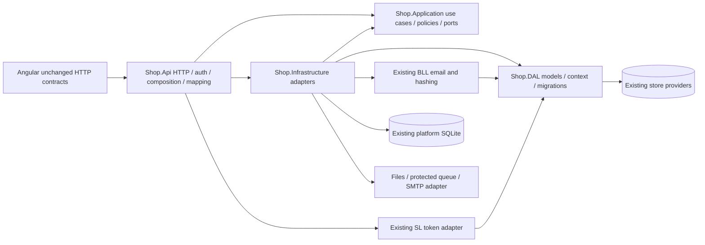

# Incremental refactoring — implementation result

Completed 2026-10-28 against baseline 4a4a1a05b180a63963d77fcaecd9104100b34c61. Persistent decisions and phase manifests: ../REFACTORING_CONTEXT.md.

## What changed

- Shop.Application owns isolated order/discount/variant/return policies and checkout, fulfillment, catalog, returns, recovery and provisioning use cases. Its assembly has no HTTP/EF/DAL/BLL/SL/Infrastructure reference (tested).
- Shop.Infrastructure implements workflow-specific persistence, serializable/CAS operations, scoped transaction sessions, recovery SQL, queue leases and encrypted-payload/transport adapters. It does not reference Shop.Api assembly (tested).
- Shop.Api remains the composition/HTTP/authorization/result-mapping boundary. Existing registration/return/queue facade classes preserve untouched callers. Simple authorized query/CRUD actions remain simple; legacy repositories were not replaced wholesale.
- Six host-resident tenancy persistence helpers were relocated to Infrastructure/Tenancy while retaining their legacy namespace/type names. No platform mapping/model change; platform registry remains SQLite, stores remain SQLite/PostgreSQL.
- Merchant settings DTOs match the old currency/status/governorate/area JSON exactly, including enum/null/nested fields. Existing error shapes, including bare ProblemDetails/empty cases, are retained.
- Program uses tested data/email/auth registration groups. Scoped mail composition awaits store translations once rather than blocking DI; worker delivery keeps the original queued language/text snapshot.

## Dependency direction

Untouched API query/CRUD endpoints still reference BLL/DAL. This is an incremental boundary, not a project rename or a blanket clean-architecture rewrite. No generic repository, CQRS/MediatR, event bus, new production package or new deployment requirement beyond Phase0 private JWT configuration.

## Preserved business guarantees

Cash-only checkout; server-authoritative totals/discount/shipping/currency; serialized request fingerprint and owner-bound durable receipt; same-key retry after an ambiguous outcome; no stock reservation at checkout; one-time conditional fulfillment deduction/restoration; protected delivered/cancelled behavior; variant/order identity protection; gallery null/empty/order semantics; manual refund cap/floor/reference; return CAS and one-time restock; shared order/receipt/outbox and return/audit/stock/outbox commit; tenant claim/asset/database isolation; plan snapshots/quotas/trial/paid verification; new-empty-database provisioning guard and unavailable failed stages. No distributed transaction promise was added.

## Evidence

| Verification | Result |
|---|---|
| Application policies/use cases |309 passed |
| Infrastructure (SQLite run) |10 passed |
| API/mapping/crypto/composition contracts |17 passed |
| Angular ChromeHeadless |13 passed |
| API and Angular production builds |passed |
| Translation audit |719 phrases, zero missing |
| JWT startup/lifetime matrix |14 cases passed |
| JWT role/issuer/audience/signature HTTP |172 checks passed |
| PostgreSQL isolated schema |33 assertions passed |
| PostgreSQL tenant HTTP |318 checks passed |
| Infrastructure under PG environment |10 passed:7 PG transaction tests,1 SQLite platform guard,2 pure composer tests |

Final full HTTP evidence: ignored src/Shop.Api/obj/refactoring-evidence/phase10-491d69fe36184c0b87480f40137f6bd1/manifest.json. All ten suites passed: API snapshots, checkout integrity, returns, localization, deployment profiles, merchant onboarding, marketplace, storefront, upload/tracking security and outbox. They include other scripts; counts are overlapping assertions, not a coverage percentage. Schema/model/migration and existing production package/Angular lockfile diffs/hashes remain unchanged. Only test dependencies were added. Tests use temporary loopback hosts/databases, never live merchants.

## Known limits and remaining risks

1. Existing operations-checks fails on both original control DLL and refactored code at blocked offline recovery child-process exit on Windows. Recovery/instance-lock production behavior was not changed. The earlier scheduler mismatch was a harness prerequisite: test-only polling now explicitly1s rather than depending on the60s production default. Child timeout cleanup preserves the failing assertion. Full offline recovery certification is NOT claimed.
2. Existing NETSDK1138 (.NET7), NU1903 (AutoMapper12) and NU1902 (JWT7.0.3) warnings remain. Runtime/package remediation is separate work, not suppressed or mixed into extraction.
3. API-wide ProblemDetails/code normalization, arbitrary merchant transition graphs, real payments/refunds and database-provider/schema migration remain outside this implementation. BLL/SL and untouched DAL request VMs remain transitional.
4. Existing unrelated CartController local text edit was preserved and excluded from formatting; it is not part of this refactoring.

## Rollback / operation

No commit, push, deployment or live API/UI restart performed. Keep an existing private signing key; committed development JWT placeholders are intentionally rejected (README). To roll back, restore only the chosen phase's code/wiring and, if necessary, source locations. Keep schemas, receipt/outbox formats, DataProtection purposes/key ring and tenant data. Never compensate stock or delete failed provisioning resources as a code rollback.

Run existing feature scripts through security-smoke using a separately built DLL and temporary fixtures. Conventional tests are in tests/Shop.Application.Tests, Shop.Infrastructure.Tests and Shop.RegressionTests, all listed in Shop.sln. Frontend: npm test -- --watch=false --browsers=ChromeHeadless. Do not repoint these test fixtures at a production database.

Final post-format focused confirmation: HTTP contract151 + checkout413 passed against the exact final DLL; manifest final-confirmation-c78ff6c394b4422baf07e1bce1299c10 under obj/refactoring-evidence. Extracted-controller literal failure messages were checked against baseline with none missing. No commit/push/deploy or production database operation occurred.
